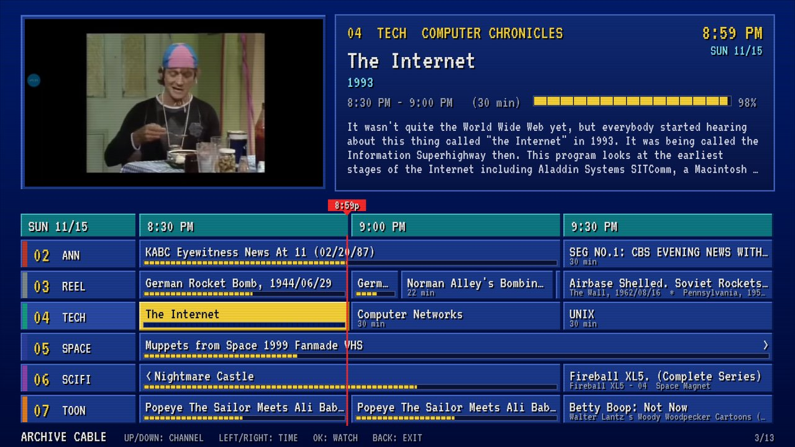
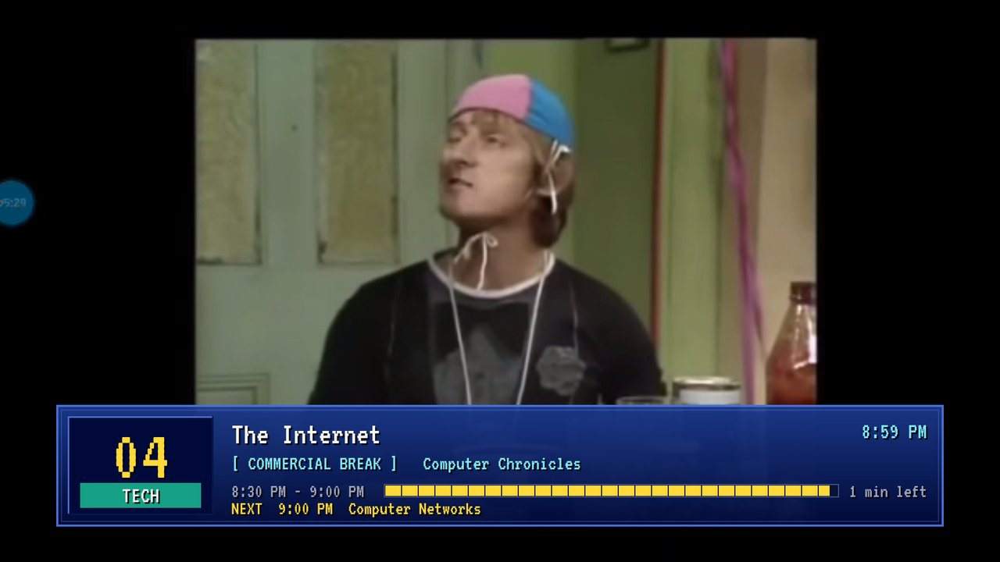
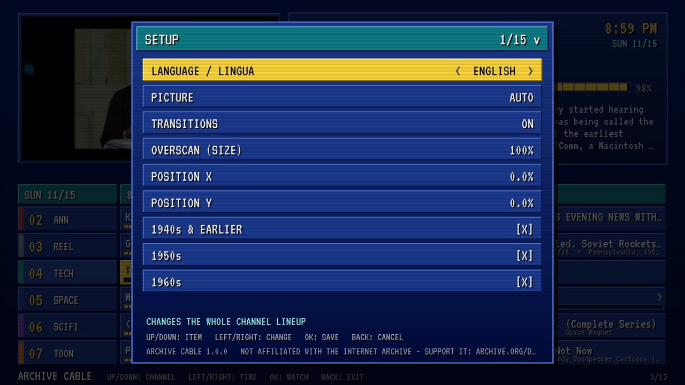
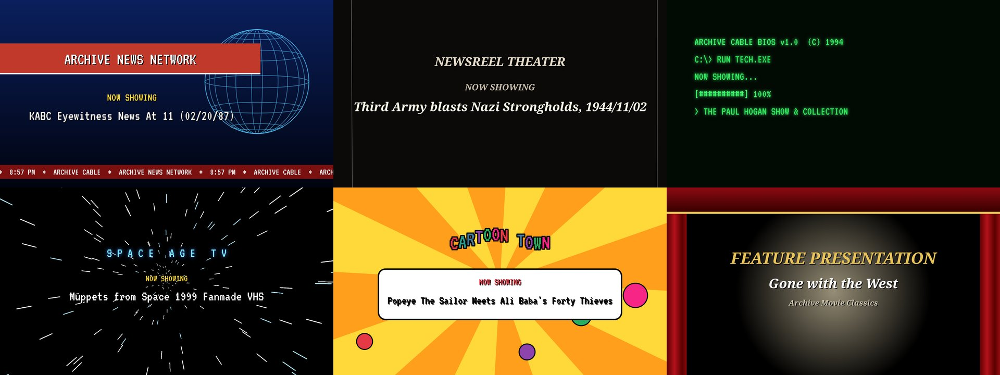

# Archive Cable

**A 90s cable TV box for Android TV and Google TV, with every channel playing video from the [Internet Archive](https://archive.org).**

Turn it on and something is already playing: newscasts, newsreels, Computer Chronicles, 50s space serials, cartoons, sitcoms, film noir, Saturday-morning VHS tapes with their original commercials. Channels follow a fixed schedule that keeps running while you're away. There's a TV guide with a red "now" line, a channel banner when you change channel, animated station idents, and vintage commercial breaks between shows.



| Channel banner | Setup menu |
|---|---|
|  |  |



## Features

* **13 themed channels** (English) or **11** (Italian), each built from an Internet Archive search
* **Live schedule**: tune in mid-show, like real TV; shows start on the hour and half hour, with gaps filled by vintage commercials
* **90s TV guide** with a live preview window, a moving "now" line and a progress bar for every current show
* **Channel banner** for 3 seconds on every channel change; ±15 s skip; channel numbers on the number keys
* **Animated station idents** with synthesized jingles, unique per channel, between shows and before ad breaks
* **Decade filter**: put only the 80s and 90s (or any mix) on the air
* **CRT ready**: auto 4:3 stretch, overscan and X/Y position calibration
* **English and Italian**: changes the whole interface *and* the programming (TG, Carosello, Cartoni Animati…)
* **Auto volume**: quiet VHS transfers and blaring commercials play at the same level
* No account, no ads, no tracking

## Install

Requires an Android TV / Google TV device running Android 8.0 or newer. Enable **Developer options** first (Settings → System → About → click *Android TV OS build* 7 times).

**With the Downloader app** (easiest, no computer needed):
1. Install **Downloader** by AFTVnews from the Play Store on your TV.
2. Allow it to install unknown apps (Settings → Apps → Security & restrictions → Unknown sources → Downloader).
3. Open Downloader and enter:
   `https://github.com/edu-m/archive-cable/releases/latest/download/ArchiveCable.apk`

**With adb** from a computer:
```sh
adb connect <tv-ip>:5555          # Google TV: pair first under Developer options → Wireless debugging
adb install -r ArchiveCable.apk    # from the latest release
```

The app shows up in the TV launcher as **Archive Cable**. The first launch takes a few seconds to load each channel; after that, lineups are cached for the week.

## Remote

| Button | Watching TV | In the guide |
|---|---|---|
| Up / Down (also CH+/CH−) | Channel up / down | Move between channels |
| Left / Right | Skip back / forward 15 s | Earlier / later programs |
| OK (also GUIDE, MENU) | Open the TV guide | Watch the selected channel |
| Back | Close the banner; press twice to exit | Close the guide |
| 0–9 | Go to a channel number | Go to a channel number |
| INFO | Show the channel banner | |
| Play/Pause | Pause; the channel stays behind live time until it changes | |

## Touch screens (phones and tablets)

Archive Cable also runs on Android phones and tablets (landscape). On screens that aren't 16:9 the picture is boxed to 16:9, like a TV.

| Gesture | Watching TV | In the guide | In SETUP |
|---|---|---|---|
| Tap | Open the guide | Select a show; tap it again (or the preview) to watch | Select a row; tap again on its left/right half to change it |
| Swipe left | −15 s | Open SETUP | Previous value |
| Swipe right | +15 s | Jump back to "now" | Next value |
| Swipe up / down | Channel up / down | Scroll the channel list | Scroll the rows |
| Long-press | Channel banner | | |

In SETUP, use the on-screen **SAVE** / **CANCEL** buttons, or tap outside the menu to cancel. The system Back gesture works like the remote's Back button.

## Setup menu (hidden)

In the guide, press **Left three times** while the current program is selected. The **SETUP** menu opens. Up/Down picks a setting, Left/Right changes it, OK saves, Back cancels.

* **Language / Lingua**: switches the interface (Italian uses a 24-hour clock and Italian dates) and the whole channel lineup. Each language has its own lineup file:
  * [channels_en.json](app/src/main/assets/channels_en.json): the English lineup below.
  * [channels_it.json](app/src/main/assets/channels_it.json): TG and Giornale Luce, Quark, Fantascienza, Cartoni Animati, Telefilm e Sceneggiati, VHS anni 80/90, Gialli, Cinema, Documentari, Videomusic, and Carosello for ads and filler. Nothing after 2005.
* **Picture**:
  * **AUTO** (default): stretches 4:3-shaped video to fill a 16:9 screen and enlarges it about 4%, the way a CRT's overscan did, which hides the black edges and noise baked into VHS captures. Widescreen video is left alone.
  * **STRETCH**: stretches everything.
  * **ZOOM**: fills the screen by cropping the top and bottom.
  * **ORIGINAL**: original shape, with black bars.
* **Transitions**: turns the channel idents on or off (see below).
* **Decades**: one checkbox per decade from the 1940s to the 2010s, plus **Undated items**. The 1940s box also covers anything older and the 2010s box anything newer. Only ticked decades are on the air. The filter is part of the Archive search, so each channel gets a full lineup from those decades; then each item's year is checked, using the year in the title when the year field is missing, or when the field looks like a later upload date. Commercials follow the same decades and fall back to any era if none are found. Saving reloads the lineup. Each combination is cached separately, so switching back is instant. Channels with nothing from your decades say so in the guide and are skipped by Up/Down. At least one box always stays ticked.
* **Auto volume** (on by default): evens out Archive recordings that are nearly inaudible or ear-piercing. Each recording's loudness is measured continuously, ignoring low-frequency hum, and the volume is adjusted toward one common level (up to ±20 dB): loud audio is turned down within about 0.3 s, quiet audio is brought up over a couple of seconds, and near-silence is never boosted. A limiter keeps boosted audio from clipping, and each new tape is re-measured quickly. Turn it off for untouched original audio.
* **Overscan (size)**, **Position X**, **Position Y**: set up the picture for a CRT. Size runs from 75% to 110% in 1% steps; X/Y move the picture up to ±10% in 0.5% steps. The video, guide, banners and idents all move and shrink together. While you adjust these, a calibration overlay appears (yellow edge, red corner brackets, center crosshair, 90% title-safe box): shrink until all four red corners are visible on the tube, then center the picture. Changes preview live; **0** resets the selected setting, OK saves, Back restores the previous values.

**Using a CRT:** connect the box through an HDMI-to-composite (AV) converter, set Picture to AUTO, then calibrate Overscan and Position. If your box offers 480p/576p output (Settings → Display), use it so the converter has less scaling to do. Text is sized for a 1080-line layout, so it is still readable on a 480-line tube.

Android TV has no system-wide setting to stretch 4:3 video. The black bars are already part of the picture the app sends to the TV, so the TV's own zoom settings would stretch or crop the guide and banners as well. That's why the stretch setting is in the app.

## Channel idents (transitions)

Each channel has its own animated ident with a synthesized jingle. It plays when a show starts ("NOW SHOWING") and before a commercial break ("WE'LL BE RIGHT BACK", with what's on after the break). The ident covers the moment the next tape is loading and stays up until that tape's first frame appears, so there's no black gap and the schedule stays on time. The show's sound fades in when the ident ends.

The `bumper` field of each channel picks the style: `news` (globe and ticker), `leader` (film countdown), `terminal` (green computer screen), `warp` (starfield), `toon` (sunburst and iris-out), `retro` (60s rainbow), `vhs` (blue PLAY screen), `noir` (venetian blinds), `curtain` (theater curtains; INTERMISSION for breaks), `neon` (80s synthwave grid). Everything is drawn and synthesized in code; no third-party idents or audio are used.

## Language filters

Each lineup file also controls two filters. `acceptLanguages` lists the allowed values of the item's IA `language` field (items with no language field are kept). `rejectPattern` is a regex checked against titles, descriptions and file names, so items with burned-in foreign subtitles ("Windows 95 - Arabic", "…subtitles", "ondertiteld", "sottotitoli") never enter the lineup. Subtitle and caption tracks are always turned off, and the player prefers audio in the selected language (useful for films with both ITA and ENG audio).

To add a language: add it to `LANGUAGES` and the strings in [I18n.kt](app/src/main/java/tv/archivecable/I18n.kt), and create `channels_<code>.json`.

## Channels

The English channels are defined in [channels_en.json](app/src/main/assets/channels_en.json). After editing it, rebuild the app.

| # | Name | Content |
|---|---|---|
| 02 | ANN | 1970s–90s local and network newscasts |
| 03 | REEL | Universal Newsreels |
| 04 | TECH | The Computer Chronicles |
| 05 | SPACE | Space-age TV and serials: Flash Gordon, Men into Space, Lost in Space… |
| 06 | SCIFI | Sci-fi and horror B-movies and TV |
| 07 | TOON | Classic cartoons |
| 08 | TVL | Classic TV |
| 09 | SAT AM | Saturday-morning VHS recordings, with their original commercials |
| 10 | NOIR | Film noir |
| 11 | FLIX | Feature films |
| 12 | EDU | Prelinger educational films |
| 13 | MTV2K | Music videos, 1978–2000 |
| 14 | ADS | Vintage commercials |

Each channel has these settings:

* `query`: an Internet Archive search query. The app adds `mediatype:movies` and the `globalExclude` safety filter automatically, then applies the language and subtitle filters described above.
* `slot`: the program grid in minutes (30 = shows start on the hour and half hour). When a show ends before its slot does, the rest of the slot is filled with vintage commercials from the `filler` query. With `0`, programs play back-to-back, and the guide groups short items into half-hour blocks.
* `minMinutes` / `maxMinutes`: the allowed program length.
* `sample`: how many search results the channel's lineup is built from.
* `bumper`: the channel's ident style (see above).

## How it works

* **Lineups**: the app searches the Internet Archive sorted by downloads and samples items with a seed that changes weekly. It reads each item's file list to choose the best h.264 file and its exact duration. Lineups are cached on the device for the week and refreshed in the background. The channel you're watching loads first.
* **Schedule** ([Schedule.kt](app/src/main/java/tv/archivecable/Schedule.kt)): a fixed loop starting from a set date, with the order shuffled each cycle. The same channel shows the same thing at the same time on any device.
* **Playback**: Media3 ExoPlayer streams directly from `archive.org/download/…`. If a file fails to play, it is skipped and its slot is filled with commercials, or with a "Please Stand By" color-bars card.

## Build from source

Requires JDK 17 and the Android SDK (API 36).

```sh
./gradlew assembleRelease      # → app/build/outputs/apk/release/app-release.apk
./gradlew testDebugUnitTest    # unit tests (schedule, decade filter)
```

Without a `keystore.properties` file, release builds are signed with your local debug key, so you can always build and sideload your own copy. Official releases are signed with the project's release key. Debug builds also accept **B** / **N** on a keyboard to preview the current channel's idents.

## About the content

Archive Cable doesn't host, copy or redistribute any video. It plays files directly from the Internet Archive, which hosts them under its own [terms of use](https://archive.org/about/terms.php). Rights in each item belong to their owners. Channels are automated searches, so what airs depends on what people have uploaded. A keyword safety filter removes adult material, but it can't catch everything. If something inappropriate shows up, please [open an issue](https://github.com/edu-m/archive-cable/issues) with the title so it can be added to the filter.

**Archive Cable is not affiliated with or endorsed by the Internet Archive.** It runs entirely on their free service and bandwidth, so if you enjoy it, please consider [donating to the Internet Archive](https://archive.org/donate).


## License

[MIT](LICENSE) © 2026 edu-m. Bundled third-party components are listed in [THIRD_PARTY_NOTICES.md](THIRD_PARTY_NOTICES.md). All channel idents, jingles and artwork are original and generated in code.

# AI disclaimer

This project has been worked on partly by AI, this means that an AI has been involved on some tasks on this codebase. Writing tests, refactoring functions, writing some comments and cleaning up the codebase are some of the tasks that have been delegated.
